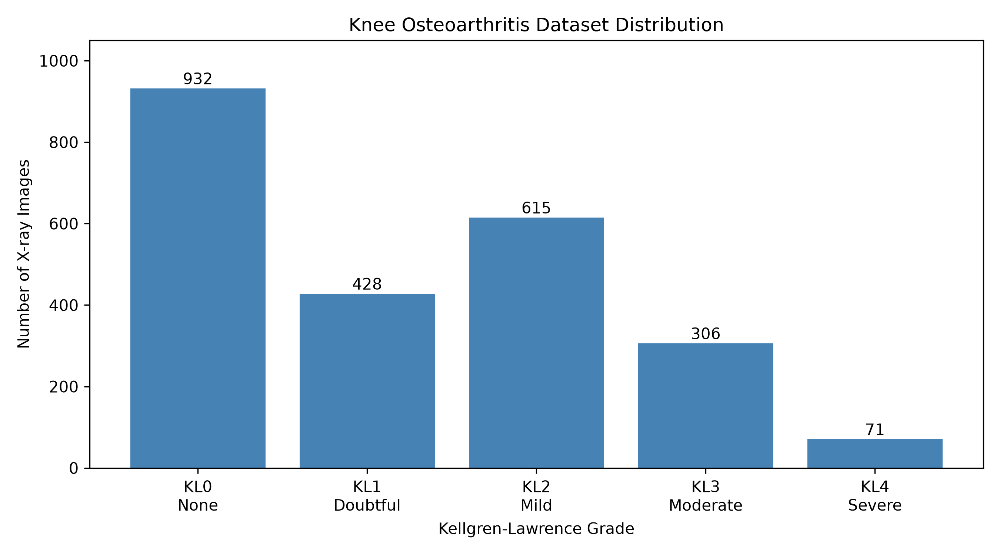
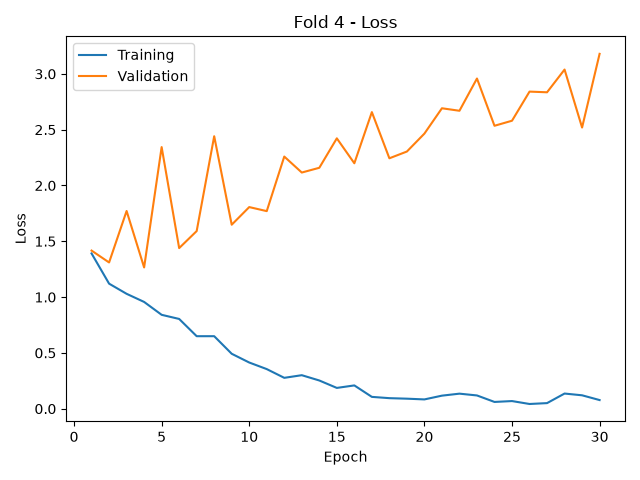
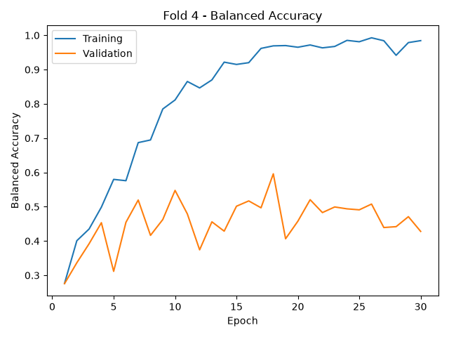
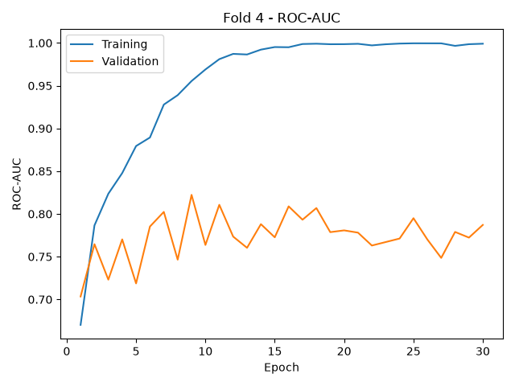
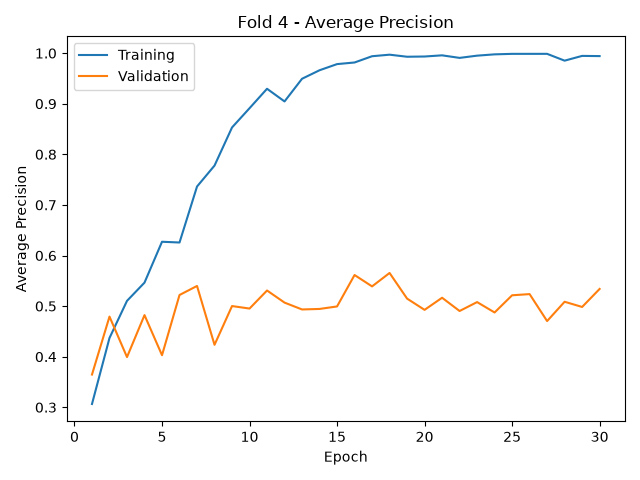
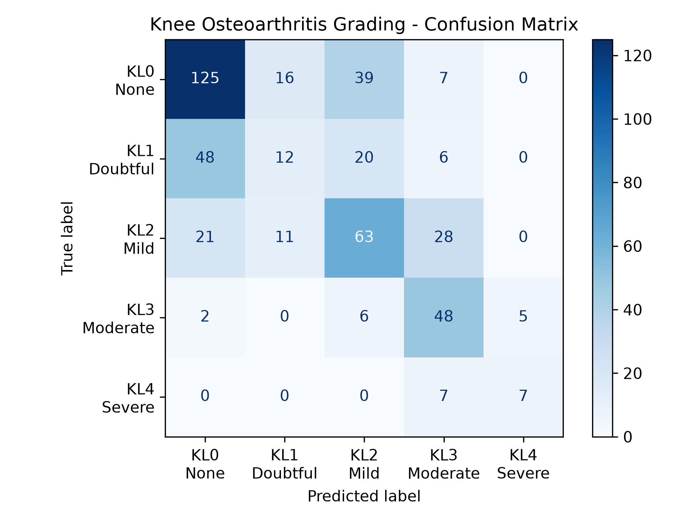

# Knee Osteoarthritis Grading Using Deep Learning

A deep learning project for classifying knee osteoarthritis severity from X-ray images using **ResNet18** and the **Kellgren–Lawrence (KL) grading system**.

The project uses PyTorch, transfer learning, stratified five-fold cross-validation, and multiple evaluation metrics to investigate model performance and generalization.

## 1. Project Overview

Knee osteoarthritis is a degenerative joint disease that can be assessed using radiographic images. The Kellgren–Lawrence grading system categorizes radiographic osteoarthritis severity into five grades, from KL0 (none) to KL4 (severe).

The objective of this project is to train a convolutional neural network to classify knee X-ray images into these five categories and evaluate its performance, particularly in the presence of class imbalance.

## 2. Dataset

The dataset contains **2,352 grayscale knee X-ray images**, each resized to 224 × 224 pixels.

| Grade | Description | Images |
|---|---|---:|
| KL0 | None | 932 |
| KL1 | Doubtful | 428 |
| KL2 | Mild | 615 |
| KL3 | Moderate | 306 |
| KL4 | Severe | 71 |
| **Total** | | **2,352** |

### Dataset Distribution



The dataset is imbalanced, with substantially more KL0 images than KL4 images. This motivates the use of balanced accuracy alongside standard classification metrics.

### Data Splitting

- **80% development set:** 1,881 images
- **20% held-out test set:** 471 images
- **Five-fold stratified cross-validation** performed on the development set

The held-out test set is kept separate from cross-validation.

## 3. Methodology

### Model Architecture

The project uses **ResNet18**, a convolutional neural network architecture available in Torchvision.

- ImageNet-pretrained weights are used for transfer learning.
- Grayscale X-ray images are converted to three channels.
- Input pixel values are normalized to the range 0–1.
- The final classification layer is replaced with a five-class output layer.

### Training Configuration

| Parameter | Value |
|---|---|
| Architecture | ResNet18 |
| Framework | PyTorch |
| Pretraining | ImageNet |
| Optimizer | Adam |
| Learning rate | 0.001 |
| Batch size | 16 |
| Loss function | Cross-entropy |
| Epochs | 30 |
| Cross-validation | 5 stratified folds |
| Model selection | Highest validation balanced accuracy |
| Hardware | NVIDIA RTX 3090 |

A separate model is trained for each fold. The checkpoint achieving the highest validation balanced accuracy is saved as `best_model_fold_<fold>.pth`.

## 4. Evaluation Metrics

The following metrics are used to assess classification performance:

- **Accuracy:** Proportion of correctly classified images.
- **Balanced Accuracy:** Average recall across the five KL grades, giving equal importance to each class.
- **Precision:** Proportion of predictions for a class that are correct.
- **Recall:** Proportion of actual images belonging to a class that are correctly identified.
- **F1-score:** Harmonic mean of precision and recall.
- **ROC-AUC:** Measures the model's ability to rank positive examples above negative examples across classification thresholds.
- **Average Precision:** Summarizes the precision–recall relationship across thresholds.

For multiclass ROC-AUC and average precision, the project uses macro-averaged one-vs-rest calculations.

## 5. Five-Fold Cross-Validation Results

The following results are from the **30-epoch ResNet18 training experiment**. Each fold's checkpoint is selected using its highest validation balanced accuracy.

| Fold | Best Epoch | Best Validation Balanced Accuracy |
|---|---:|---:|
| Fold 1 | 25 | 56.11% |
| Fold 2 | 28 | 53.94% |
| Fold 3 | 10 | 51.42% |
| Fold 4 | 18 | **59.60%** |
| Fold 5 | 4 | 51.98% |
| **Mean** | — | **54.61%** |

The reported mean is the average of the five best validation balanced accuracy values. It is not a held-out test score.

### Training and Validation Curves

The following plots show **Fold 4**, which achieved the highest validation balanced accuracy in this experiment.

#### Loss



#### Balanced Accuracy



#### ROC-AUC



#### Average Precision



Training and validation metrics were tracked at every epoch. Four plots were generated for each of the five folds.

## 6. Overfitting Analysis

The training curves reveal evidence of **overfitting**.

For example, in Fold 4:

| Metric | Epoch 1 | Epoch 30 |
|---|---:|---:|
| Training loss | 1.3911 | 0.0776 |
| Validation loss | 1.4168 | 3.1795 |

Training loss decreased substantially, indicating that the model fitted the training data increasingly well. However, validation loss increased and validation balanced accuracy fluctuated, suggesting limited generalization and increasingly overconfident errors on unseen validation images.

Fold 4 achieved its highest validation balanced accuracy of **59.60% at epoch 18**, rather than at the final epoch.

Selecting the best checkpoint using validation balanced accuracy helps avoid automatically using the final, potentially overfitted model.

Possible improvements include data augmentation, regularization, early stopping, learning-rate scheduling, and further investigation of class imbalance.

## 7. Held-Out Test Evaluation

The following held-out test results were obtained using an earlier pretrained ResNet18 baseline, rather than the checkpoints from the 30-epoch cross-validation experiment.

A separate, earlier pretrained ResNet18 baseline experiment was evaluated on the **471-image held-out test set**.

These results are **not** from the new 30-epoch checkpoints presented above.

| Metric | Result |
|---|---:|
| Test accuracy | 54.14% |
| Test balanced accuracy | 52.14% |
| Macro F1-score | 0.50 |
| Weighted F1-score | 0.52 |

### Classification Performance by Grade

| KL Grade | Precision | Recall | F1-score | Support |
|---|---:|---:|---:|---:|
| KL0 — None | 0.64 | 0.67 | 0.65 | 187 |
| KL1 — Doubtful | 0.31 | 0.14 | 0.19 | 86 |
| KL2 — Mild | 0.49 | 0.51 | 0.50 | 123 |
| KL3 — Moderate | 0.50 | 0.79 | 0.61 | 61 |
| KL4 — Severe | 0.58 | 0.50 | 0.54 | 14 |

### Confusion Matrix



The confusion matrix shows that the model struggles particularly with **KL1 (doubtful)**, which achieved only 14% recall in this test evaluation. This highlights the difficulty of distinguishing subtle radiographic changes between neighboring KL grades.

## 8. Installation

Clone the repository:

```bash
git clone https://github.com/Yasubst/knee-osteoarthritis-grading.git
cd knee-osteoarthritis-grading
```

Install the Python dependencies:

```bash
pip install -r requirements.txt
```

For GPU acceleration, install a PyTorch build compatible with your CUDA environment using the official PyTorch installation instructions.

The dataset is not included in the GitHub repository and must be obtained separately.

## 9. Running the Project

Place the labeled X-ray images in the expected dataset directory:

```text
data/archive/Labeled/
├── 0/
├── 1/
├── 2/
├── 3/
└── 4/
```

Generate the dataset CSV splits:

```bash
python data_preparation.py
```

Train the model using pretrained ResNet18 and five-fold cross-validation:

```bash
python main.py -epochs 30 -num_folds 5 -pretrained -output_dir out
```

The training script saves the best checkpoint for each fold and four training-versus-validation plots per fold.

Run the existing baseline held-out test evaluation:

```bash
python evaluate.py -test
```


## 10. Limitations and Future Work

The project has several limitations:

- **Class imbalance:** KL4 contains only 71 images in the full dataset.
- **Limited dataset size:** Deep learning models can overfit when training data is limited.
- **Neighboring-grade ambiguity:** KL grades, particularly KL0–KL2, may be difficult to distinguish.
- **Overfitting:** Validation loss increased during later training epochs.
- **Generalization:** Performance on images from other institutions, imaging devices, or patient populations has not been established.

Future work could explore data augmentation, improved regularization, class-balanced training strategies, alternative architectures, and external validation.

## 11. Technologies Used

- Python
- PyTorch and Torchvision
- Scikit-learn
- OpenCV
- NumPy and Pandas
- Matplotlib
- NVIDIA CUDA

## 12. Disclaimer

This project was developed for educational and experimental purposes. It is **not a clinically validated diagnostic system** and should not be used to make medical decisions.